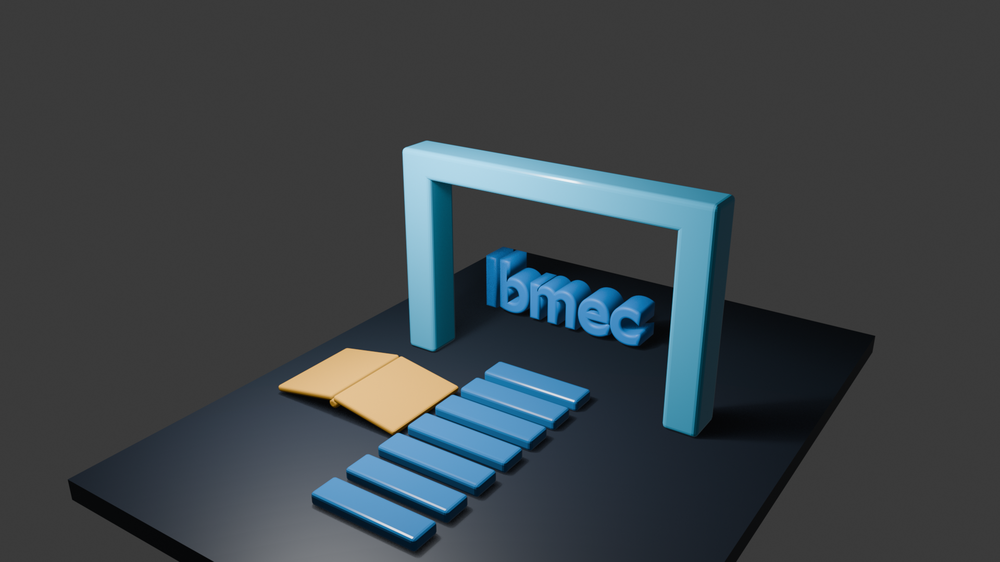
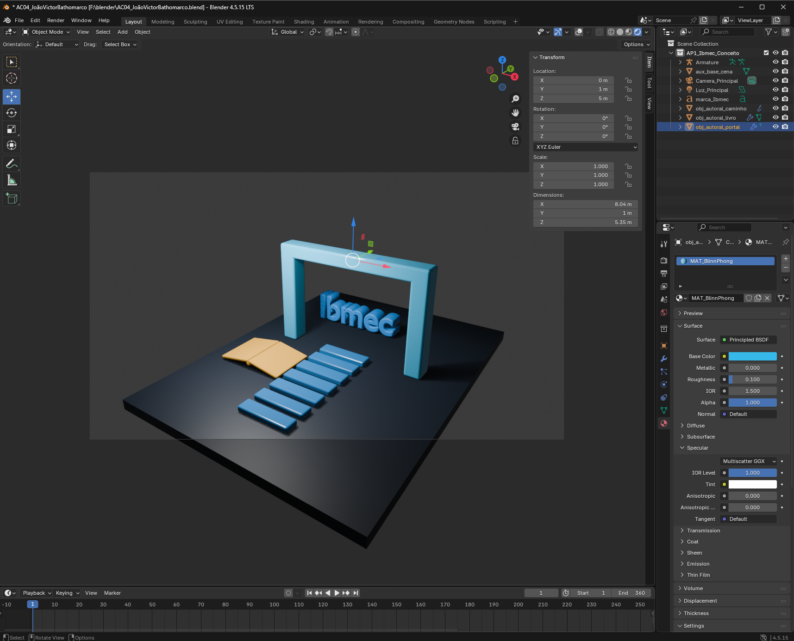

# AC04 — Evolução da Cena: Modelos de Iluminação

**Aluno:** João Victor Bathomarco  
**Matrícula:** 202302902448  
**Curso / Disciplina / Turma:** Engenharia da Computação — Computação Gráfica — Turma 8001  
**Software:** Blender 4.5.15 LTS  
**Projeto:** `AC04_JoãoVictorBathomarco.blend`

## 1. Continuidade da AP1

A atividade foi desenvolvida a partir de uma cópia da cena da AP1, preservando o projeto original. A composição apresenta a palavra Ibmec, um livro aberto, um caminho modular e um portal. Esses elementos representam o conhecimento, a trajetória de aprendizado e a chegada ao objetivo da formação acadêmica.

Foram mantidos os três objetos autorais, suas formas e suas cores principais. A cena recebeu iluminação para evidenciar as superfícies e novos ajustes nos materiais. O enquadramento foi ampliado para 33 mm, e a palavra foi deslocada para ficar totalmente legível entre as colunas do portal. A entrega desta atividade é estática. O render foi gerado em EEVEE, com resolução de 1920 × 1080 pixels, a 100%.

## 2. Objetos e parâmetros dos materiais

Foi utilizado o shader Principled BSDF nos três materiais, com os seguintes parâmetros:

| Objeto no Outliner | Material | Cor-base (hexadecimal) | Metallic | Roughness | IOR principal | Specular → IOR Level |
|---|---|---|---:|---:|---:|---:|
| `obj_autoral_livro` | `MAT_Lambert` | `#E5A93D` — dourado | 0,000 | 1,000 | 1,500 | 0,000 |
| `obj_autoral_caminho` | `MAT_Phong` | `#2474B5` — azul | 0,000 | 0,200 | 1,500 | 0,500 |
| `obj_autoral_portal` | `MAT_BlinnPhong` | `#36B9E8` — ciano | 0,000 | 0,100 | 1,500 | 1,000 |

O IOR principal e o IOR Level são controles diferentes. O IOR principal foi mantido em 1,500; o IOR Level foi usado para ajustar a intensidade da camada especular. No livro, o IOR Level igual a zero elimina a reflexão especular dessa camada, produzindo a aparência fosca utilizada na comparação.

## 3. Configuração da iluminação

Foi utilizada uma luz principal, identificada como `Luz_Principal`, com a seguinte configuração final:

| Parâmetro | Valor |
|---|---|
| Tipo / formato | Area / Square |
| Cor | Branco |
| Potência (Power) | 1800 W |
| Exposure | 0,000 |
| Size | 3 m |
| Normalize | Ativado |
| Shadow | Ativado |
| Location — X, Y, Z | −3 m; −4 m; 8 m |
| Rotation — X, Y, Z | 25°; −20°; 0° |

A luz foi organizada na coleção `AC04_Iluminacao`. Os objetos da composição e a câmera permanecem na coleção `AP1_Ibmec_Conceito`. Não foi adicionada uma segunda luz de preenchimento. Na imagem final e na captura comparativa, os três objetos recebem a mesma configuração de iluminação, e o enquadramento da câmera é o mesmo.

## 4. Comparação das aparências

**Lambert — livro:** o dourado apresenta aparência fosca, sem uma faixa de brilho especular evidente. A iluminação difusa e as sombras permitem perceber as páginas inclinadas e a lombada.

**Phong — caminho:** a menor rugosidade e a presença da camada especular produzem aparência mais polida. No render, aparecem faixas claras principalmente nas bordas arredondadas dos blocos.

**Blinn-Phong — portal:** a rugosidade ainda menor e o IOR Level mais alto favorecem reflexos mais concentrados. O render mostra um brilho localizado na barra superior, enquanto as faces laterais apresentam diferentes níveis de iluminação.

A comparação é qualitativa: os objetos também possuem geometrias, orientações e cores diferentes, que influenciam o resultado. Por isso, a imagem não constitui uma comparação matemática isolada entre as equações dos três modelos.

## 5. Observação do ângulo da luz

Foi realizado um teste temporário, deslocando a luz para Location X = 3 m e alterando Rotation Y para 20°. Permaneceram iguais a potência, a cor, o tamanho da luz, os materiais e o enquadramento da câmera.

Nessa posição, a região direita do portal ficou mais iluminada, e a distribuição dos brilhos e das sombras mudou. O livro continuou fosco, mas suas regiões claras e escuras também se alteraram. O teste mostra que a orientação da luz influencia tanto a iluminação difusa quanto a localização dos reflexos especulares.

Após a observação, foram restaurados Location X = −3 m e Rotation Y = −20°, correspondentes à configuração escolhida para a entrega.

## 6. Limitação técnica das aproximações

O Principled BSDF é um shader baseado em princípios físicos. Renomear seus materiais para Phong e Blinn-Phong e ajustar Roughness e IOR Level não implementa literalmente as equações clássicas desses modelos. Nesta atividade, os nomes identificam aproximações visuais, conforme permitido pelo enunciado.

O material Lambert também foi representado visualmente por uma superfície difusa e sem reflexão especular no Principled BSDF. Não foram implementadas equações personalizadas de iluminação.

## 7. Imagens e arquivos da entrega

**Render final:**

**Captura adicional de comparação:**

- `AC04_JoãoVictorBathomarco.blend` — cena atualizada.
- `AC04_JoãoVictorBathomarco_Final.png` — render final.
- `AC04_JoãoVictorBathomarco_Comparacao.png` — captura adicional da cena em Rendered, com os parâmetros do portal visíveis.
- `AC04_JoãoVictorBathomarco_Relatorio.md` — este relatório.

## Referências

- [Enunciado da AC04 — Jonh Carvalho](https://jonh-carvalho.github.io/CG_26.2_8001/Avalia/AC04/).
- [Blender 4.5 LTS — Principled BSDF](https://docs.blender.org/manual/en/4.5/render/shader_nodes/shader/principled.html).
- [Blender 4.5 LTS — Light Objects](https://docs.blender.org/manual/en/4.5/render/lights/light_object.html).
