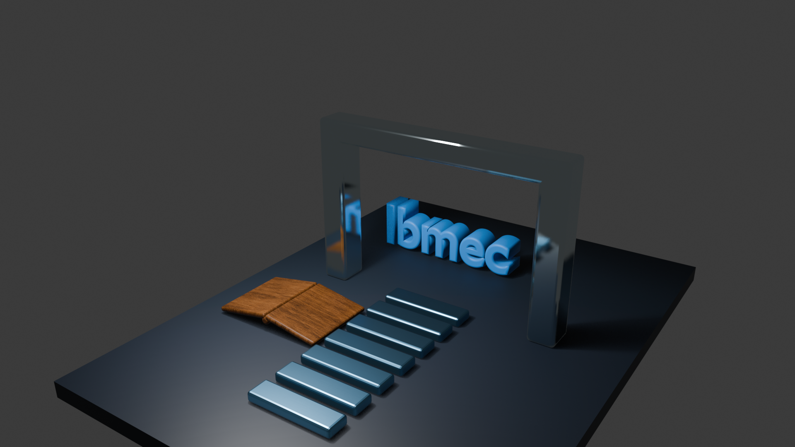

# AC05 — Materiais PBR e Texturas

**João Victor Bathomarco** · Matrícula 202302902448  
Engenharia da Computação · Computação Gráfica · Turma 8001  
Prof. Jonh Carvalho · Blender 4.5.15 LTS

## Cena e materiais

A cena foi desenvolvida a partir da AC04. A composição apresenta um livro aberto, um caminho modular e um portal que enquadra a palavra Ibmec. A marca usa o material azul sólido `MAT_Ibmec_Azul` da AC04, com cor `#168BE8` e Roughness 0,500. A palavra permanece legível no render. [Enunciado da AC05](https://jonh-carvalho.github.io/CG_26.2_8001/Avalia/AC05/)

| Objeto | Material no Principled BSDF | Base Color | Roughness | Metallic | IOR |
|---|---|---|---:|---:|---:|
| Livro (`obj_autoral_livro`) | `MAT_Livro_Madeira_PBR` | Mapa Wood066 | Mapa Wood066 | 0,000 | 1,500 |
| Caminho (`obj_autoral_caminho`) | `MAT_Caminho_Metal_Escovado` | Azul `#6FAAD1` | 0,350 | 1,000 | 1,500 |
| Portal (`obj_autoral_portal`) | `MAT_Portal_Espelhado` | Ciano-claro `#E1F2F8` | 0,040 | 1,000 | 1,500 |

## Mapas e coordenadas UV

| Objeto | Imagem | Espaço de cor | Conexão |
|---|---|---|---|
| Livro | `Wood066_1K-JPG_Color.jpg` | sRGB | Color → Base Color |
| Livro | `Wood066_1K-JPG_Roughness.jpg` | Non-Color | Color → Roughness |
| Livro | `Wood066_1K-JPG_NormalGL.jpg` | Non-Color | Color → Normal Map (Tangent Space, Strength 1,000) → Normal |
| Caminho | `Metal009_1K-JPG_NormalGL.jpg` | Non-Color | Color → Normal Map (Tangent Space, Strength 0,350) → Normal |

O livro foi desdobrado com **Smart UV Project**, que separou as faces largas das tiras estreitas das laterais e da lombada. As ilhas foram conferidas sobre o mapa de cor para avaliar a distribuição e a orientação dos veios. O caminho usa o UV em cruz do bloco-base. O modificador **Array** replica o bloco com suas coordenadas UV, repetindo o padrão escovado nas peças.

Os quatro mapas são do ambientCG, em 1024 × 1024 pixels, sob a licença **CC0 1.0 Universal**. As imagens usadas nos materiais estão incorporadas ao arquivo Blender via **Pack Resources**. [Wood066](https://ambientcg.com/view?id=Wood066) · [Metal009](https://ambientcg.com/view?id=Metal009) · [Licença](https://docs.ambientcg.com/license/)

## Iluminação e resultado

A câmera principal de 33 mm e a luz de área branca de 1.800 W e 3 m vieram da AC04. Para mostrar os reflexos no portal, a AC05 usa **Raytracing** com **Screen-Trace** no EEVEE. A luz destaca os veios do livro e forma faixas claras nas bordas do caminho. O portal tem reflexos mais nítidos, com a marca e o livro visíveis no pilar esquerdo. As faces que refletem o entorno escuro aparecem mais fechadas.

## Evidências

- [Cena do Blender](AC05_JoãoVictorBathomarco.blend)
- [Shader Editor do material de madeira](AC05_Shader_Madeira.png)
- [UV Editor do livro sobre o mapa de cor](AC05_UV_Livro.png)

